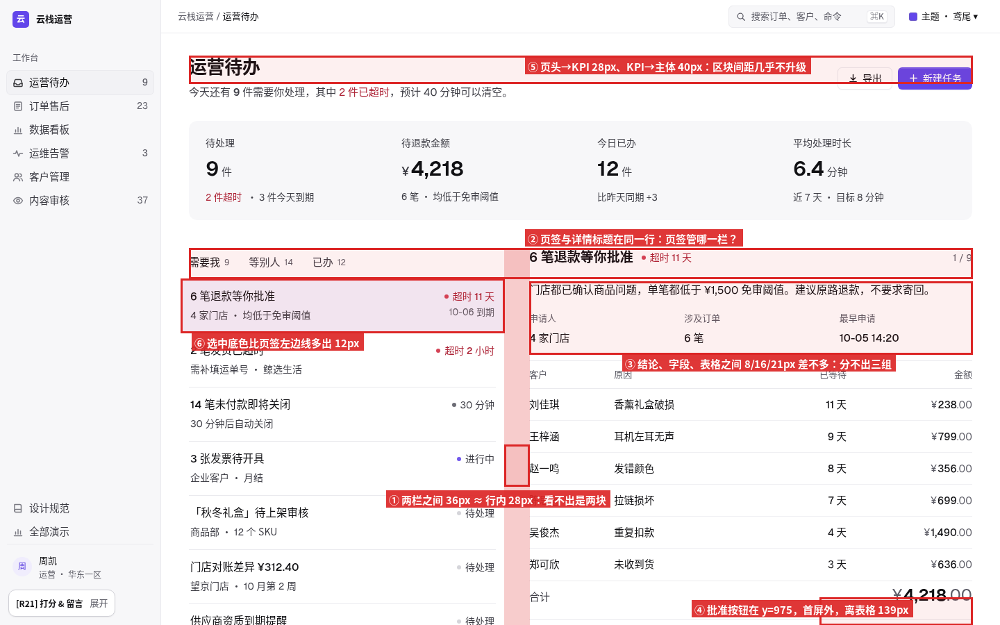
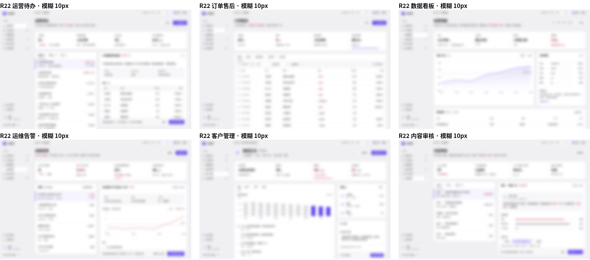
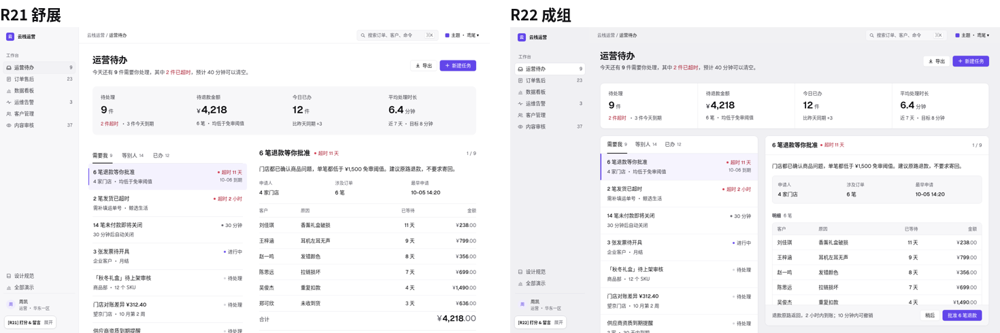

# R22「成组」研究笔记：让分组不用读就看得出来

> 触发：R21 得 55/100，备注「依然很吃力，当前的演示页内容需要人脑去归类页面元素哪些是一组」。
> 本轮只解决一个问题：**眯眼（模糊 10px）也能数出页面有几块、每块里有几组**。
> 截图对照来自真实产品（只做内部比对，不随站点发布）。

## 1. 依据（来源）

| 来源 | 要点 | 本轮怎么用 |
|---|---|---|
| NN/g · Proximity Principle in Visual Design https://www.nngroup.com/articles/gestalt-proximity/ | 靠得近的元素被看成一组；**关系靠相对距离**，不是绝对值。 | 组内 / 组间比 ≥ 2 作为硬指标 |
| NN/g · Common Region https://www.nngroup.com/articles/common-region/ | 同一边界内的元素被看成一组（Palmer 1992），强于接近性；但容器用多了会制造“假地板”、互相抵消。 | 只给“对象”配容器；面板里不套面板 |
| Atlassian Design · Spacing https://atlassian.design/foundations/spacing | 8px 基数；小 0–8（组件内）、中 12–24（组件间）、大 32–80（版块）；“Group by proximity”。 | 关系令牌 4/8/16/24/32 |
| Carbon · Spacing https://carbondesignsystem.com/elements/spacing/overview/ | 2/4/8/12/16/24/32/40/48 刻度；同组用小步、组间用大步。 | 刻度只取其中 6 档 |
| Primer · Layout / Split page https://primer.style/foundations/layout | 列表 + 详情是两个独立 pane；pane 自己滚动；侧栏分组用发丝线 + 间距。 | 列表、详情各一块面板，详情面板内滚动 |
| Ant Design · 亲密性 / 布局 https://ant.design/docs/spec/proximity · https://ant.design/docs/spec/layout | 纵向间距 8 / 16 / 24 三档（y = 8 + 8n），关系越远档位越大；灰底 + 白卡片的后台骨架。 | 两层底色、24 卡片间距的上限参照 |
| Shopify Polaris · Section / Card https://polaris-react.shopify.com/components/layout-and-structure/card | 一个 Section：标题、内容、主操作在同一容器里。 | 规则 G2「一个对象一个面板」 |
| Material 3 · Spacing https://m3.material.io/foundations/layout/understanding-layout/spacing | 隐式分组（间距）与显式分组（容器、分隔线）；先隐式，必要时显式。 | 面板内用间距，面板外用容器 |
| Practical UI（Adham Dannaway）/ Tailwind Catalyst | 四种成组手段：容器、接近、相似、连续；间距由内向外加大；外边距 ≥ 内边距。 | 面板内边距 20 ≥ 组内 16 |
| X：@3xProduct_D（Hilda Bliss）、@marina_uiux | 共同区域是最强线索，但别每样东西都装卡片；避免“盒子套盒子”。 | 井（浅底）只用一层 |

### 真实界面测量（1440×900 截图，像素）
- **Ant Design Pro 详情页 / 分析页**：灰画布 + 白卡片；卡片间距 ≈ 24，卡片内边距 24，卡片头 ≈ 56（带发丝线）；描述列表 标签→值 ≈ 4–8，行距 16；卡片里的分组靠 24 + 组标题，不再套卡片。
- **GitHub PR 页侧栏**：组标题→内容 ≈ 8，组与组之间 发丝线 + 16；正文与侧栏是两个区域，主操作（Merge）放在它作用的那块框里。
- **Stripe Dashboard**：白底，用分组标题 + 32 以上空白分区；表格与筛选条在同一区域。
- **Linear / Attio**：画布与面板只差一档灰，面板圆角 8–12；列表与详情是两块并排的面板，详情操作贴在面板头或底。
- **Polaris Storybook**：Section 内 标题→内容 16，内容→操作 16，Section 之间 20。

结论：成熟后台几乎都是「浅灰画布 + 白色面板」两层，并且**面板之间的缝 ≥ 面板内任何组间距的一半以上、远大于行内间距**；R21 的“纯白 + 留白分组”只有在组间距 ≥ 40、组内 ≤ 8 时才成立，R21 实际达不到。

## 2. 可度量的分组规则

| # | 规则 | 度量 | 对 | 错 |
|---|---|---|---|---|
| G1 | 组内近、组间远 | 组间 ÷ 组内 ≥ 2；逐层 4 → 8 → 16 → 24 → 32 | 标签贴值 4，字段之间 16，组之间 24 | 所有间距 12–16 一样多 |
| G2 | 一个对象一个区域 | 标题、内容、主操作在同一面板；主操作与它作用的内容距离 ≤ 1 屏，且不出首屏 | 批准按钮在详情面板底部操作条 | 按钮离表格 139px、掉到首屏以下 |
| G3 | 两层底色 | 画布 #F0F0F3 / 面板 #FFF + 1px #E1E1E7；面板里最多一层浅底井 #F7F7F9 | 面板 → 井 | 卡片里套卡片、处处描边 |
| G4 | 标签贴值 | 标签→值 4；标签对之间 ≥ 16（列间 24）；同组的标签对放进一个井 | 3 个事实一行、一个井 | 标签与上一行值同距 |
| G5 | 工具条分两组 | 筛选一组靠左（间距 8），操作一组靠右；两组之间弹性空白；工具条和它控制的表格同一面板 | 搜索 / 门店 / 类型 ┊ 更多筛选 · 导出 | 按钮、筛选混排一行 |
| G6 | 列表与详情各一块 | 两块面板中缝 20（≥ 行内边距 14 的 1.4 倍且有边界）；页签放进列表面板头（高 52）；选中行 3px 左条贴面板边 | 页签只属于左栏 | 页签与详情标题在同一水平线 |
| G7 | 面板头与内容 | 面板头 56 + 发丝线；面板体内边距 20；面板底操作条浅底 | — | — |

**何时用哪种手段**
- **容器（面板）**：可独立操作的对象（一条待办、一张表、一个客户卡片、KPI 组）。
- **浅底井**：面板内一组并列事实（申请人 / 订单 / 时间），最多一层。
- **组标题（13/600）+ 24 空白**：面板内的第二组（如「明细 6 笔」），不加框。
- **发丝线**：同组内的多条同构行（列表行、联系人）。
- **纯空白**：页头与第一块面板（32）、标签与值（4）。
- **表格 vs 详情**：表格整块进一个面板（筛选条在面板内浅底）；详情是另一块面板，不共享边框。

## 3. R21 demo.html 诊断

DOM 实测（1440×900）：
1. **列表 ↔ 详情只隔 36px**，而列表行上下留白 28px：比值 1.3，眼睛分不出这是两块。
2. **页签「需要我 / 等别人 / 已办」与详情标题在同一 y=357**：读者要猜页签管哪一栏。
3. **详情里结论、字段、表格的间距 8 / 16 / 21**：几乎一样，没有层级。
4. **批准按钮在 y=975**，离它作用的表格 139px、在首屏以下，中间隔着动态记录。
5. **区块间距 28 / 40 不统一**，KPI 带与列表的关系和列表行之间的关系看起来差不多。
6. **选中行底色外溢 12px**，越过了列表的视觉边界，边界更模糊。

## 4. 眯眼测试（模糊 10px）

- R21：模糊后只剩一片白和几条灰带，数不出块。
- R22：能数出 页头 / KPI 面板 / 列表面板 / 详情面板 四块，详情内还能看到井和明细表两组，与 Ant Design Pro、GitHub PR 的结构感相当。

六个演示全部过测：

前后对比：

## 5. R22 实测（demo.html，1440×900）
- 页头 → KPI 面板 32；KPI 面板 → 列表 / 详情面板 20；列表 ↔ 详情中缝 20（各自有边框）。
- KPI：标签 → 数值 4，数值 → 说明 4；格子之间竖线。
- 详情：结论 → 井 16，井内 标签 → 值 4、列间 24，井 → 明细组 24，组标题 → 表格 8。
- 详情面板高 560（贴合视口），操作条在 y=817–878，首屏内可见；内容在面板内滚动。

## 6. 迭代记录
- **迭代 1**：画布 #F5F5F7 + 白面板 → 模糊后面板边界太淡，画布加深到 #F0F0F3、面板描边 #E1E1E7；详情操作条在首屏以下 → 详情面板改为贴合视口的粘性面板，头 / 操作条钉住；运维页详情顶部多出空白 → 首个字段井去掉上外边距；运维 / 内容页面板底操作条补齐。
- **迭代 2**：规范「分组」章的组件展示被三列网格挤窄 → 改成两列独立布局；展示里的状态圆点用字形渲染偏大 → 改为 6px 圆点；客户页「联系人」面板首行比行距多 20 的内边距、分隔线偏重 → 列表型面板体上下内边距 4，分隔线改发丝线；六个演示统一模糊复测通过；深色主题 midnight 检查面板与画布仍可区分。
