# R23「精修」· R22 审计

> R22「成组」得 58/100（R21 是 55），没有留言。R23 不改 R22 的成组系统（灰画布 + 白面板 + 4/8/16 · 20 · 24 · 32 间距档），目标是让六个演示看起来像**已经上线、打磨过的产品**，而不是规范演示。
> 方法：1440×900、Chrome 无头，逐页量 DOM（`audit.js`：红字、主按钮、字号、面板头高度、面板边界、原生控件、截断、整页高度），再和真实产品截图并排看，最后做眯眼测试（模糊 10px）。

## 参照（真实产品截图，仅内部使用，不上传）

| 产品 | 看什么 | 来源 |
|---|---|---|
| Linear Inbox / Initiatives | 列表 + 详情分栏、页签计数、行内两行结构、翻页 | linear.app/changelog 产品图 |
| Stripe Dashboard · Invoices | 表格：表头、ID 列、金额对齐、筛选按钮条、行尾菜单 | docs.stripe.com/invoicing 产品图 |
| Vercel · Deployments / Usage | 面板头：标题 + 右侧轻按钮；一行统计 | vercel.com/docs 产品图 |
| Attio · Table | 高密度表格、选中行、列头 | attio.com 产品表格截图 |
| GitHub · Issues / Pulls | 列表头里的筛选下拉 + 计数、行尾元信息 | github.com/vercel/next.js 的 issues、pulls 页 |
| 飞书管理后台 | 字段组：左标签右内容、分组标题 | 飞书帮助中心管理后台截图 |
| Polaris admin | Section 结构、卡片头 | 之前存的 polaris 截图（Polaris 站点现跳转到 shopify.dev，只剩小片段） |

## R22 逐页标注

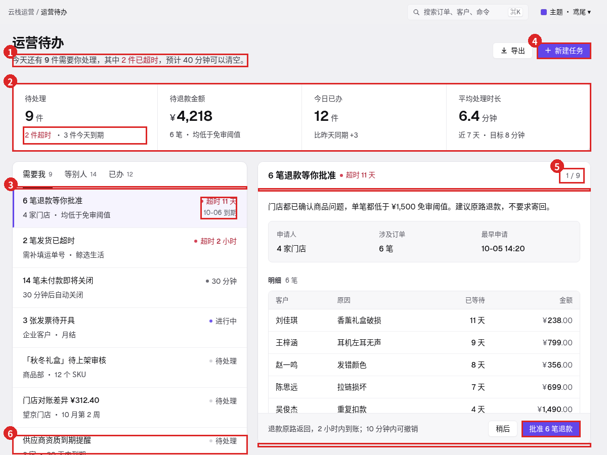
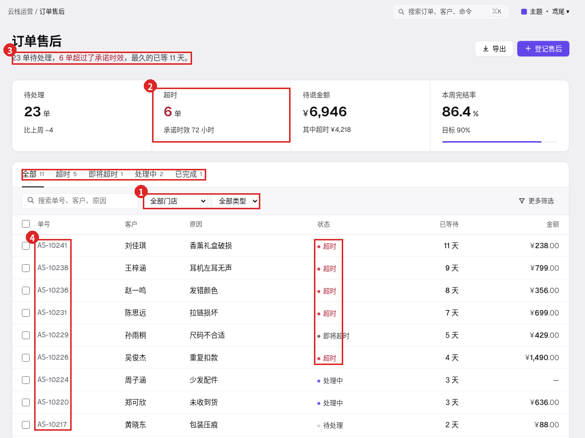
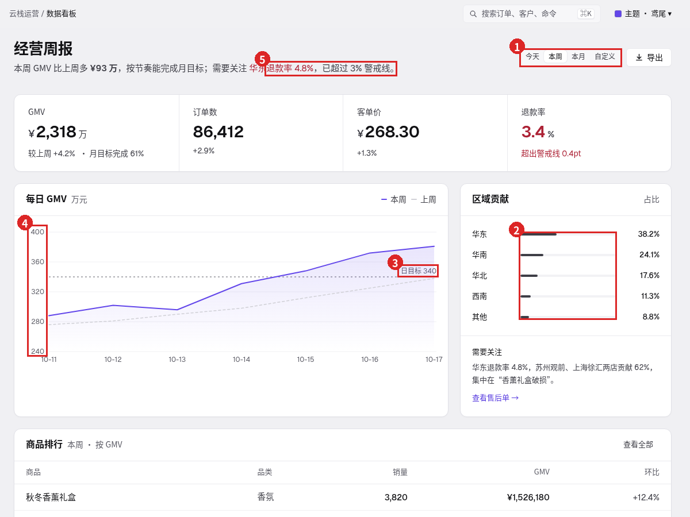
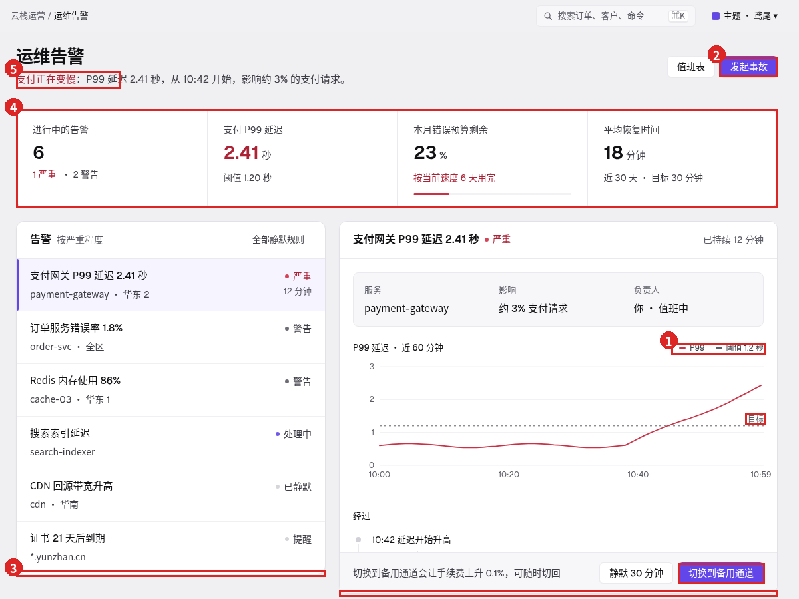
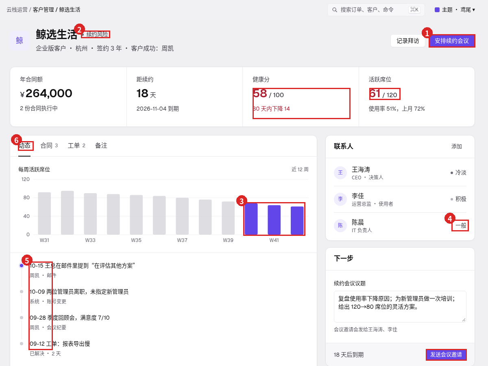
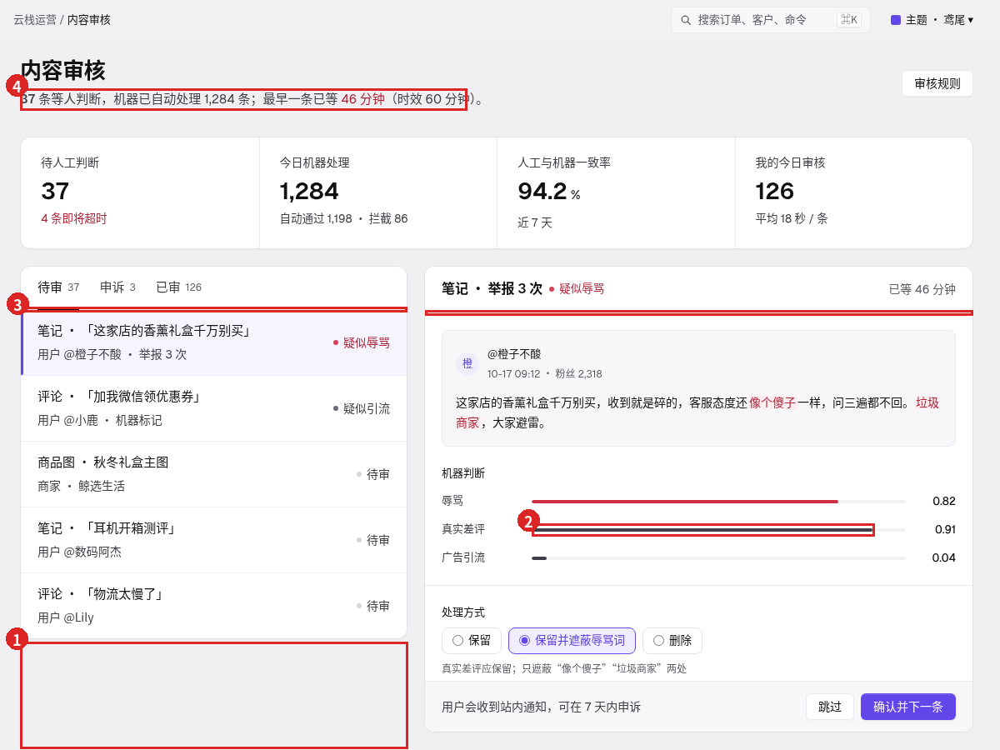

并排（R22 vs 真实产品）：

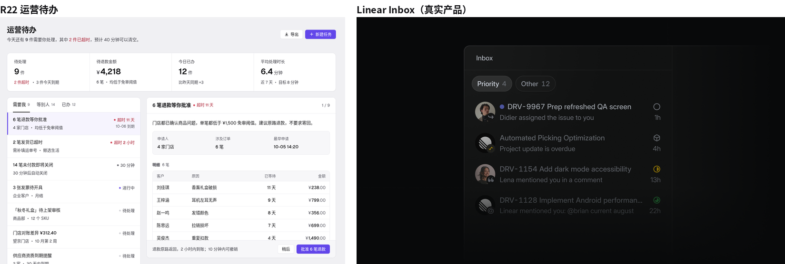
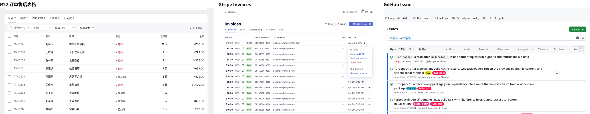
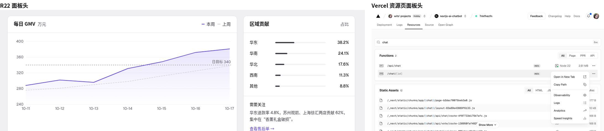
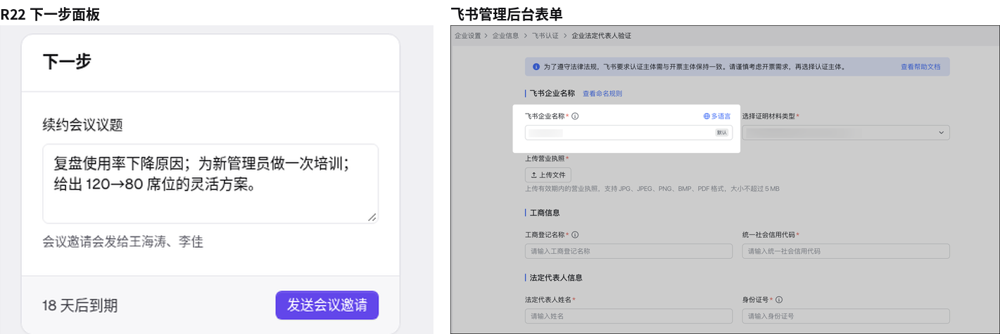

## 28 处问题（按阅读负担从高到低）

**A · 焦点打架**（眼睛不知道先看哪）

1. **同屏 2 个主按钮**：运营待办（新建任务 + 批准）、运维告警（发起事故 + 切换到备用通道）、客户管理（安排续约会议 + 发送会议邀请）。Linear / Vercel 每屏只有当前对象的那一个主操作。
2. **红字太多**：每屏红色文字 R22 = 5 / 7 / 3 / 6 / 3 / 6（按六页顺序），页头说明、KPI 数字、列表、详情头都有红。
3. **页头说明是一句带红字的长句**（运营待办、订单、看板），像写给评审看的说明文字，不像产品。
4. **鸢尾进了图表**：客户管理的周活跃席位柱子用鸢尾，和主按钮抢。
5. **黑色数据条**：看板“地区”条和内容审核“真实差评”条用近黑色（`.track i:not(.bad)` 覆盖了 mute），模糊后是全页最重的块。

**B · 同一个信息说好几遍 / 留白分配**

6. **工作台页的 4 格 KPI 和列表计数重复**：“9 件 · 2 件超时”同时出现在页头长句、KPI、页签计数；KPI 占 135px，没有新信息。
7. **内容审核左栏只到一半**：列表底边 y=767，详情 y=879，下面露出 112px 空画布。
8. **截止时间只在悬停时出现**：运营待办行高不一致（有的 2 行、有的 1 行），扫读时信息时有时无。
9. **客户时间线把日期写进标题**（“10-12 续约沟通”），日期列不对齐。
10. **页签名不对内容**：客户页“动态”页签里放的是席位图表。

**C · 尺寸与网格**

11. **字号 8–10 档**：13.5 / 14.5 / 15.5 / 17 / 18 … 都在用（六页分别 10 / 9 / 10 / 8 / 9 / 8 档）。
12. **面板头 52 和 56 混用**：同一行相邻面板的头部分隔线差 4px（运营待办、客户、内容审核）。
13. **KPI 高度 135 / 148 两种**：主体起点 y=319 或 332，翻页时内容在跳。
14. **列表 / 详情底边不齐**：运营待办 1013 / 879，内容 767 / 879，运维 863 / 892。
15. **KPI 标签 x=289，面板内容 x=285**：差 4px，左缘不在一条线上。
16. **客户页右栏卡片间距 16**，而全站面板间距 20。
17. **工作台页整页滚动**（scrollHeight 1061 / 940 / 927）：滚下去详情底部操作条跟着走，列表头也滚没了。

**D · 演示感控件**

18. **原生 select**：订单筛选 2 个原生下拉，带系统箭头，高度和按钮不一样。
19. **分段控件 22 高**，旁边按钮 32 高。
20. **“1 / 9” 没有翻页按钮**：只是一个看不懂的数字；Linear 在这个位置放上 / 下箭头。
21. **列表面板头没有排序控件**：按什么排的看不出（GitHub、Linear 都在列表头右侧放排序 / 视图下拉）。
22. **表格细节**：订单号不是等宽数字、没有行尾“⋯”菜单、表头 12 号偏小偏灰；列表行没有可见的键盘焦点环。

**E · 数据对不上**（真实产品里这是 bug）

23. 订单页 KPI“已超时 6”，页签“超时 5”。
24. 订单页 KPI“待处理 23”，页签“全部 11”、表格 11 行。
25. 运维图里虚线标“目标”，图例写“阈值”。
26. 运营待办状态和时间写法混用：状态列写“30 分钟”（是倒计时不是状态）；时间有“10-06 到期 / 今天 / 本周”三种精度，三行“本周”排不出先后。
27. 内容审核队列没有等待时间 / 时效；看板金额没有单位说明。

**F · 图标与状态一致性**

28. 下拉箭头、翻页、更多菜单用文字字符（›、∨、…）而不是同一套线性图标；客户页联系人“一般”没有状态圆点，打破了“状态 = 圆点 + 文字”。

## 修法（按上面的顺序）

| # | 改了什么 | 落在哪 |
|---|---|---|
| 1 | 每屏最多一个鸢尾主按钮：“新建任务”“发起事故”改成次按钮；客户页去掉页头“安排续约会议”主按钮，改为“记录拜访 + ⋯”，发送邀请保留为该面板唯一主操作 | `r23_pages.py` |
| 2–3 | 红色只给超时类状态；页头长句改成一行统计（工作台）或短元信息（总览） | `.stats`（polish ②） |
| 4–5 | 图表数据一律中性灰（`color-mix` 文字色 38%）；客户席位下滑段用 48% 深灰而不是鸢尾；`.track i.mute` 强制浅灰 | polish ⑪ |
| 6 | 工作台页去掉 KPI 格，统计并到页头一行（9 待处理 · 2 已超时 · ¥4,218 待退款 · 12 今日已办），数字随操作实时更新（含侧栏计数） | C1 |
| 7, 14, 17 | 工作台页 = 分栏视图：页面高度 100vh − 48，两块面板同顶同底（154 → 876），列表和详情各自滚动，整页不滚；列表底部“已显示 7 / 37 条” | C8，polish ④ |
| 8 | 列表行固定 2×2：标题 / 时间，元信息 / 状态；截止时间常显 | C7，polish ⑤ |
| 9–10 | 时间线日期放到右侧小字；页签改名“概览” | crm |
| 11 | 字号收成 12 / 13 / 14 / 15 / 16 / 26 / 28 七档，数字一律 tabular-nums | polish ① |
| 12–13 | 所有面板头、页签头 52；KPI 面板统一 139 高 | polish ③⑨ |
| 15–16 | KPI 内边距 20，标签对齐到 x=285；右栏 `.stack` 间距 20 | polish ⑨⑫ |
| 18–19 | 统一的按钮式下拉 `.dd`（弹出菜单、单选勾、↑↓/Esc），工具条 56 高，所有控件 32 高 | C5，polish ⑦ |
| 20 | 对象头右侧“1 / 9 + 上 / 下按钮”，J / K 键也能翻 | C4 |
| 21 | 列表页签头右侧“按截止时间”下拉 | C3 |
| 22 | 订单号等宽数字；行尾悬停出现“⋯”；表头 13 / 500；行 focus-visible 环 | polish ⑥⑧ |
| 23–27 | 订单：待处理 10、已超时 5、涉及 ¥6,034（其中超时 ¥3,582），页签 / 表格 / 分页“共 11 单”一致；运维统一叫“阈值 1.2”；状态改成“即将关闭”，时间统一为“今天 HH:MM / 明天 / MM-DD”；内容队列 7 条都带等待时间，详情写“已等 46 分钟 · 时效 60 分钟”；看板“单位：万元” | 数据 |
| 28 | 新增线性图标 chev-d / chev-u / more / check；联系人“一般”改为标签 | ICONS |

把以上收成规范页「组合」一章的 **8 个组合**，每个都有对 / 错现场渲染：
C1 页头 · C2 面板头 · C3 页签头 · C4 对象头 · C5 工具条 · C6 字段组 · C7 列表行 · C8 分栏视图。

## 修后对比

| 页 | 红字 | 主按钮 | 字号档 | 面板头 | 原生 select | 整页高 | 两栏底边 |
|---|---|---|---|---|---|---|---|
| 运营待办 | 5 → 4 | 2 → 1 | 10 → 7 | 52/56 → 52 | 0 → 0 | 1061 → 900 | 1013/879 → 876/876 |
| 订单售后 | 7 → 6¹ | 1 → 1 | 9 → 7 | 52 → 52 | 2 → 0 | 1090 → 1070 | — |
| 数据看板 | 3 → 1 | 0 → 0 | 10 → 7 | 56 → 52 | 0 → 0 | 1122 → 1108 | — |
| 运维告警 | 6 → 3 | 2 → 1 | 8 → 6 | 56 → 52 | 0 → 0 | 940 → 900 | 863/892 → 876/876 |
| 客户管理 | 3 → 1 | 2 → 1 | 9 → 8² | 52/56 → 52 | 0 → 0 | 1223 → 1232 | — |
| 内容审核 | 6 → 5 | 1 → 1 | 8 → 6 | 52/56 → 52 | 1 → 1³ | 927 → 900 | 767/879 → 876/876 |

¹ 剩下 6 处都是表格状态列的“超时”。² 多出的一档是头像字（18）。³ 是表单里的“处理原因”，已去掉系统外观、用自定义箭头。

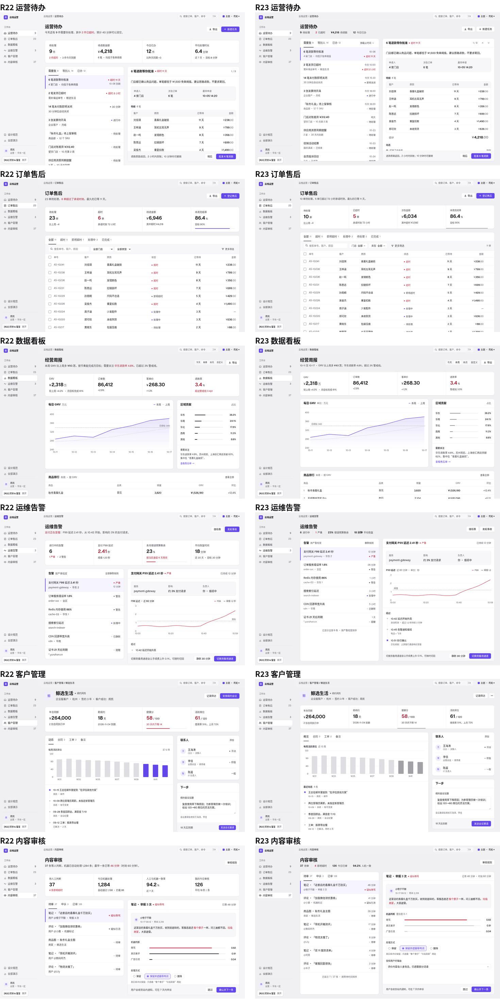
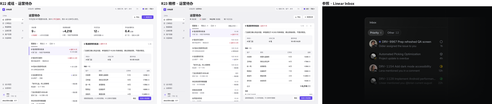
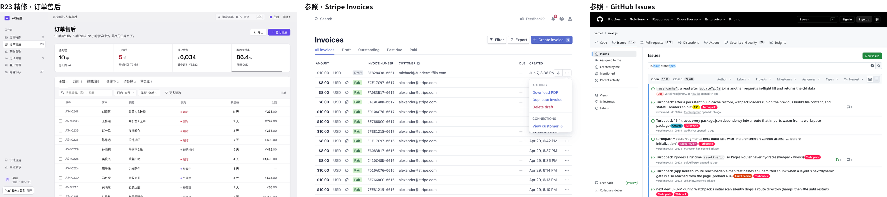

## 眯眼测试（模糊 10px）

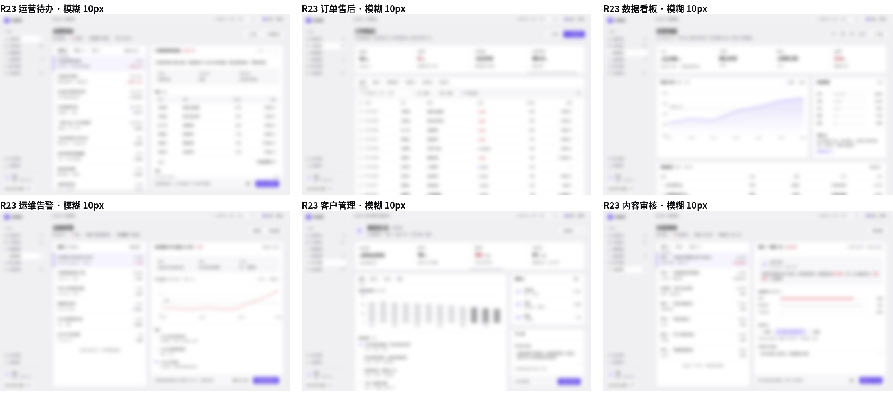

每页只剩一个鸢尾色块（当前对象的主操作）；红点只在状态位置；工作台页两块面板同顶同底；客户页最重的块是下滑的三根灰柱（就是要看的那个信息）。

## 三轮自查记录

- **第 1 轮**（主修之后）：跑 `audit.js`，主按钮每页 ≤ 1、字号 7 档、面板头全部 52、分栏同高 154–876；交互测试：下拉筛选到 2 行、翻页到“2 / 9”、K 返回、悬停 / 选中 / 焦点都可见，无报错。眯眼通过。
- **第 2 轮**（对齐与细节）：KPI 内边距 24 → 20，标签回到 x=285；内容审核“真实差评”条仍是黑色 → 加 `.track i.mute` 覆盖；合计金额字号 20 / 28 行高；规范页组合示例里按钮和“11 单”折行 → nowrap、C1 示例重排。
- **第 3 轮**（状态与边界）：把运营待办全部处理完 → 发现页头“2 已超时 · ¥4,218 待退款”和侧栏“9”不更新（数据对不上）→ 改成随操作实时计算，超时为 0 时不再标红；详情空状态原来垂直居中、和列表空状态不在一条线 → 改成顶部对齐并给出“今天已办 N 件”；客户页三根深灰柱在眯眼图里压过其他内容 → 70% → 48%；1280×760 下列表行无截断；midnight 深色主题下面板、分隔线、选中态正常。
