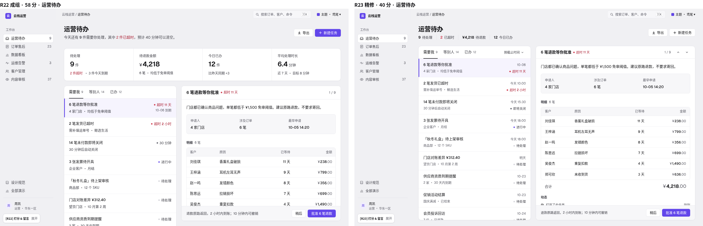
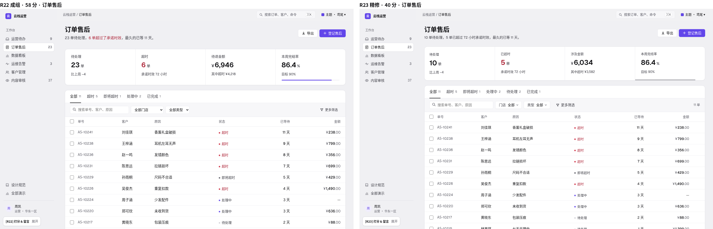
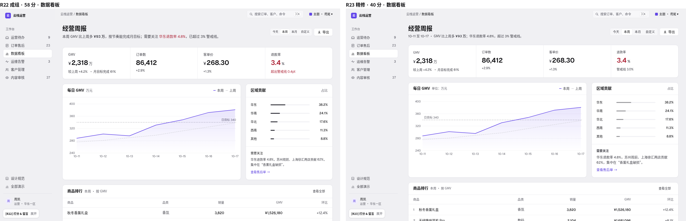
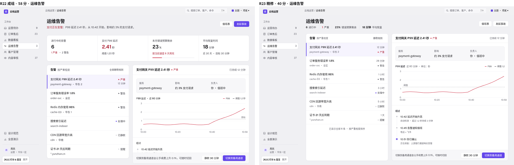
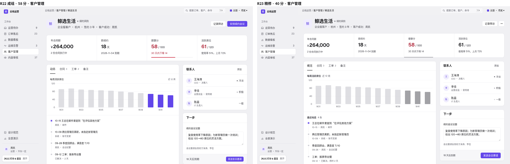
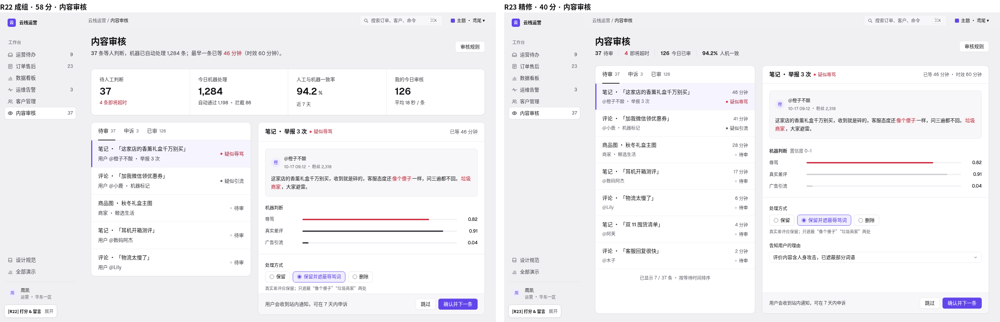
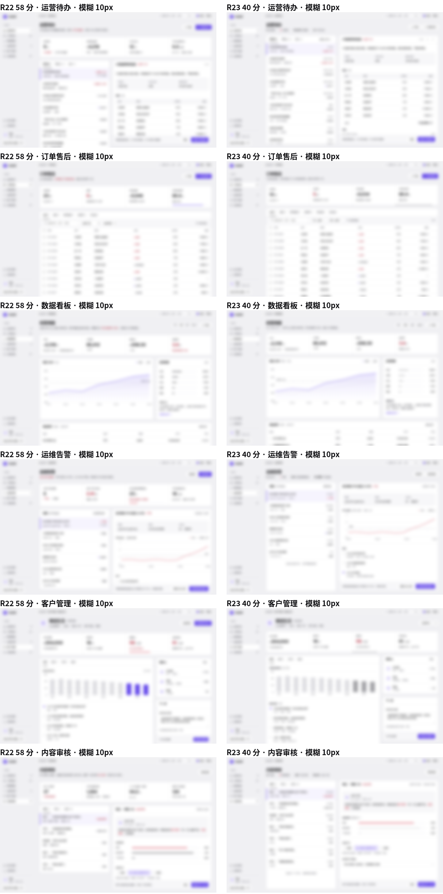
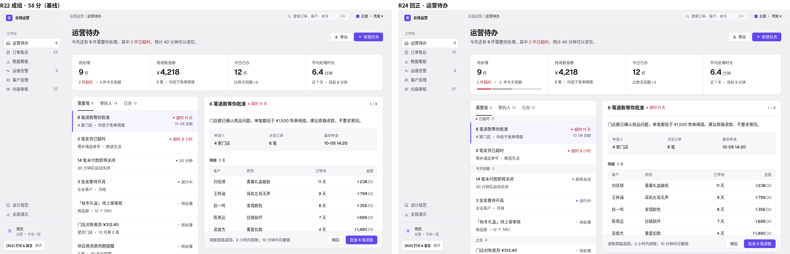
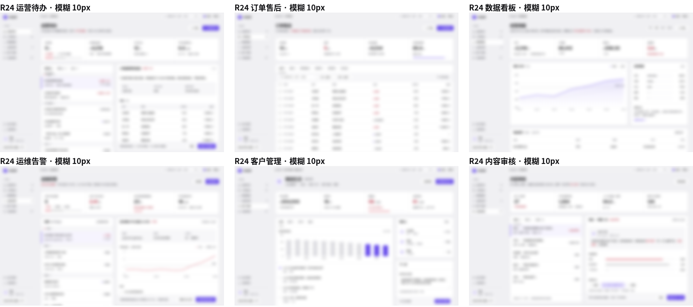

# R24 · 回归分析：R23 为什么从 58 掉到 40

> 评分：R21 55 → R22「成组」58 → R23「精修」**40**，三轮都没有留言，都是在 demo.html 上打的分。
> 所以本轮把 **R22 当成基线**（目前最高分），先找出 R23 改了哪些看得见的地方、哪些最可能让分数变低，再从 R22 出发做 R24。
> 方法：R22、R23 六个演示都在 1440×900、默认鸢尾主题、反馈面板收起的状态下截图，并排比较、做眯眼对比（模糊 10px），再用同一个脚本量首屏的文字量、按钮数、24px 以上的大字、彩色块。
> 注意：没有留言，下面的排序是根据截图和测量做的**推断**，不是 Xiang 的原话。如果之后转达了他的说法，以他说的为准。

## 并排截图（左 R22 58 分，右 R23 40 分）

眯眼对比：

## 首屏测量（1440×900，只算视口内）

| 页面 | 24px 以上的大字（R22 → R23） | 按钮 / 可点控件 | 首屏文字（字） | 彩色块（鸢尾 / 红色底） |
|---|---|---|---|---|
| **运营待办（打分页）** | **8 → 1**（9 件、¥4,218、12 件、6.4 分钟全没了） | 15 → 20 | 656 → 635 | 3 → 2 |
| 订单售后 | 5 → 5 | 9 → 22 | 436 → 476 | 3 → 2 |
| 数据看板 | 5 → 5 | 7 → 7 | 417 → 427 | 2 → 2 |
| 运维告警 | **5 → 1** | 12 → 12 | 598 → 533 | 5 → 3 |
| 客户管理 | 5 → 5 | 9 → 9 | 450 → 460 | 4 → 2 |
| 内容审核 | **5 → 1** | 12 → 14 | 519 → 516 | 3 → 3 |

文字总量基本没变，变的是**结构**：工作台页的大数字没了，可点的东西变多了，彩色变少了。

## 运营待办（打分页）上所有看得见的差异

| # | R22（58） | R23（40） | 判断 |
|---|---|---|---|
| D1 | 页头下面一块四格 KPI：9 件 / ¥4,218 / 12 件 / 6.4 分钟，28–30px 大字 + 单位 + 一句说明 | 去掉，换成页头下 14px 的一行“9 待处理 │ 2 已超时 │ ¥4,218 待退款 │ 12 今日已办” | **最可能的主因** |
| D2 | 页头副标题是一句人话：“今天还有 9 件需要你处理，其中 2 件已超时，预计 40 分钟可以清空。” | 删掉，只剩数字 | 很可能有影响：丢了“结论先行”的那句话 |
| D3 | 右上角“新建任务”是鸢尾主按钮，页面上方有一个颜色锚点 | 改成次按钮，上半屏只剩灰 | 可能有影响（变平） |
| D4 | 列表和详情从 y≈270 开始，上面有呼吸空间；详情面板贴合视口 | 从 y=154 开始，两块面板撑满整屏、各自滚动；首屏能看到 8 行（R22 是 6 行） | 可能有影响：整屏都是密集的行，像一面字墙 |
| D5 | 列表行：右上角是状态（红色“超时 11 天”），到期时间只在部分行出现 | 固定 2×2：右上角是时间、右下角是状态；每行都多一个时间 | 可能有影响：每行要读的东西多了，红色状态挪到不显眼的右下角 |
| D6 | 页签头只有页签 | 页签头右侧多一个“按截止时间 ⌄”下拉 | 小 |
| D7 | 详情头“1 / 9” | “1 / 9”加上 / 下两个图标按钮 | 小（但按钮数 15 → 20 部分来自这里） |
| D8 | 面板头 52 / 56 混用（发丝线差 4px） | 统一 52 | 几乎看不出，**不是原因** |
| D9 | 字号 10 档（13.5、14.5、15.5、17…） | 7 档 | 肉眼几乎看不出，**不是原因** |
| D10 | 明细合计 26px | 20px | 小 |
| D11 | 列表底部没有任何说明 | 列表底部多一行“已显示 n / m” | 小 |

## 其他五页的差异

- **运维告警、内容审核**：和运营待办一样去掉了 KPI，大字 5 → 1；运维的红色 KPI“2.41 秒”没了，页面上方失去了“出事了”的信号。
- **客户管理**：席位柱状图最后三根从**鸢尾**变成灰；健康分“58 / 100”和席位进度条不再是红色；页头主按钮去掉。整页从“有一个明显的风险点”变成“全是灰”。
- **数据看板**：结构没变；地区条从黑变灰，退款率的红色变成中性。变化最小。
- **订单售后**：KPI 保留，数据改对了（待处理 10、超时 5），原生下拉换成按钮式下拉，每行多一个悬停才出现的“⋯”（按钮数 9 → 22 主要来自这里）。看起来差不多，是“正确性修正”。

## 对每个候选原因的判断（按可能性排序）

1. **去掉 KPI 面板 → 页面失去锚点和总览**（很可能，影响最大）。打分页 demo.html 上大数字从 8 个变成 1 个（只剩页标题）。眯眼图里 R22 是“页头 → 指标带 → 两块面板”三层，一眼就能分清；R23 的工作台页只剩两根高柱子，纹理均匀，分不出层次。R22 的主题恰好是“一眼看出成组”，R23 把最显眼的一组拿掉了。
2. **数字挤进页头一行 → 更难读**（很可能，和 1 是同一件事的另一面）。14px 的“数字 + 标签 + 竖线”要逐个读，大字 + 单位 + 说明扫一眼就够。人话副标题（“预计 40 分钟可以清空”）也一起没了。
3. **撑满一屏、各自滚动的面板 + 每行多一个时间 → 像字墙**（较可能）。首屏能看到的列表行从 6 行变成 8 行，每行 4 段文字；留白从“上松下紧”变成“处处一样紧”。
4. **中性灰图表、红色变少 → 平淡、没精神**（较可能，主要在客户、运维两页；打分页上影响是第 3 位的“鸢尾按钮变灰”）。“颜色只给操作和状态”这条规则本身没错，但 R23 把有意义的强调（风险段、超时 KPI）也一起去掉了。
5. **控件和按钮变多**（影响较小）。下拉、翻页按钮、⋯ 让可点控件变多，但大多数是轻按钮，不算主要原因。
6. **7 档字号、52 面板头**（基本没影响）。肉眼看不出，可以保留，也可以不保留。

**结论**：R23 是在一个“正确”的审计清单上做减法，减掉的恰好是 R22 得分的东西：**指标面板的总览和锚点、结论先行的副标题、有意义的颜色强调、页面上松下紧的节奏**。R24 回到 R22，只带回不改变观感的正确性修正。

## R24 怎么处理 R23 的每一项改动

| R23 改动 | R24 | 理由 |
|---|---|---|
| 去掉工作台页 KPI，数字并入页头一行 | **不带** | 主因 |
| 删掉页头人话副标题 | **不带** | 结论先行 |
| 页头主按钮降级、客户页去掉主按钮 | **不带** | 保留 R22 的颜色锚点 |
| 图表改中性灰、客户柱子变灰 | **不带** | 保留 R22 的生气 |
| 撑满一屏的分栏 + 各自滚动 | **不带**；只在列表比详情短时（内容审核）把列表面板拉到和详情一样高，并加列表底部计数 | 底边对齐但不改变节奏 |
| 列表行固定 2×2、时间常显 | **不带** | 每行少读一段 |
| 订单 KPI / 页签 / 表格数据一致 | **带** | 正确性 |
| 原生 select → 按钮式下拉 | **带**（只在订单工具条） | 真实控件，观感不变 |
| 运维“目标 / 阈值”统一 | **带** | 正确性 |
| 状态写法（“30 分钟”→“即将关闭”）、具体日期代替“本周” | **带** | 正确性 |
| 内容审核“真实差评”条黑色 bug | **带** | bug |
| 客户联系人“一般”补状态样式 | **带** | 一致性 |
| 相邻面板头高度对齐 | **带**（统一 56，不是 52） | 看不出、无害 |
| 翻页按钮、排序下拉、行尾 ⋯ | **不带** | 少一些控件 |
| 7 档字号 | **不带** | 看不出，不冒险 |

## R24 做了什么（第二阶段）

从 R22 的构建脚本出发（tools/build_r24.py = build_r22.py + 一组补丁，不是从 R23 出发），新增样式层 r24.css 最后加载。

**带回的 R23 正确性修正**（观感不变）：订单数据前后一致（待处理 10、超时 5、涉及 ¥6,034 / 其中超时 ¥3,582；页签加“待受理 2”，与 KPI 的“待处理”区分；分页“共 11 单”；侧栏计数 10）；订单门店 / 类型筛选改成按钮式下拉，并真的能筛；运维虚线标“阈值”，与图例一致；运营待办状态“30 分钟”→“即将关闭”，“本周”→ 具体日期；内容审核判断条颜色 bug；客户联系人“一般”补圆点；页签头 52 → 56，与同一行的面板头 / 对象头对齐（运营待办两条发丝线都在 y=390）；内容审核列表面板拉到和详情同底（879 / 879），底部写“已显示 5 / 37 条”。

**两处保守改进**：
1. **列表按紧急程度分段**（运营待办：已超时 2 / 今天到期 3 / 之后 4；运维：严重 1 / 警告 2 / 其他 3）。依据：Gestalt 的共同区域、Miller 的组块；Linear 按状态分组、Gmail 优先收件箱。组标题是 32 高的浅底条，不加新颜色、不加新按钮。
2. **指标分段条与列表同序同色**（运营待办“待处理”、运维“进行中的告警”）。依据：Cleveland & McGill，长度比数字读得快；同色同序把指标和列表连成一组。处理掉一件，分段条、说明、副标题、侧栏计数一起变；超时为 0 时不再标红。

**首屏测量（R22 → R24）**：运营待办大字 8 → 5（指标面板四个数字都在，明细合计被 4px 分段条挤到首屏下方）、按钮 15 → 14、彩色块 3 → 4；运维大字 5 → 5；内容审核 5 → 5。

自查：眯眼图六页都还是“页头 → 指标带 → 工作面板”三层；midnight 深色主题下组标题、分段条正常；全部办完后列表显示空状态，计数归零；订单下拉筛选、待受理页签可用；无脚本报错。
